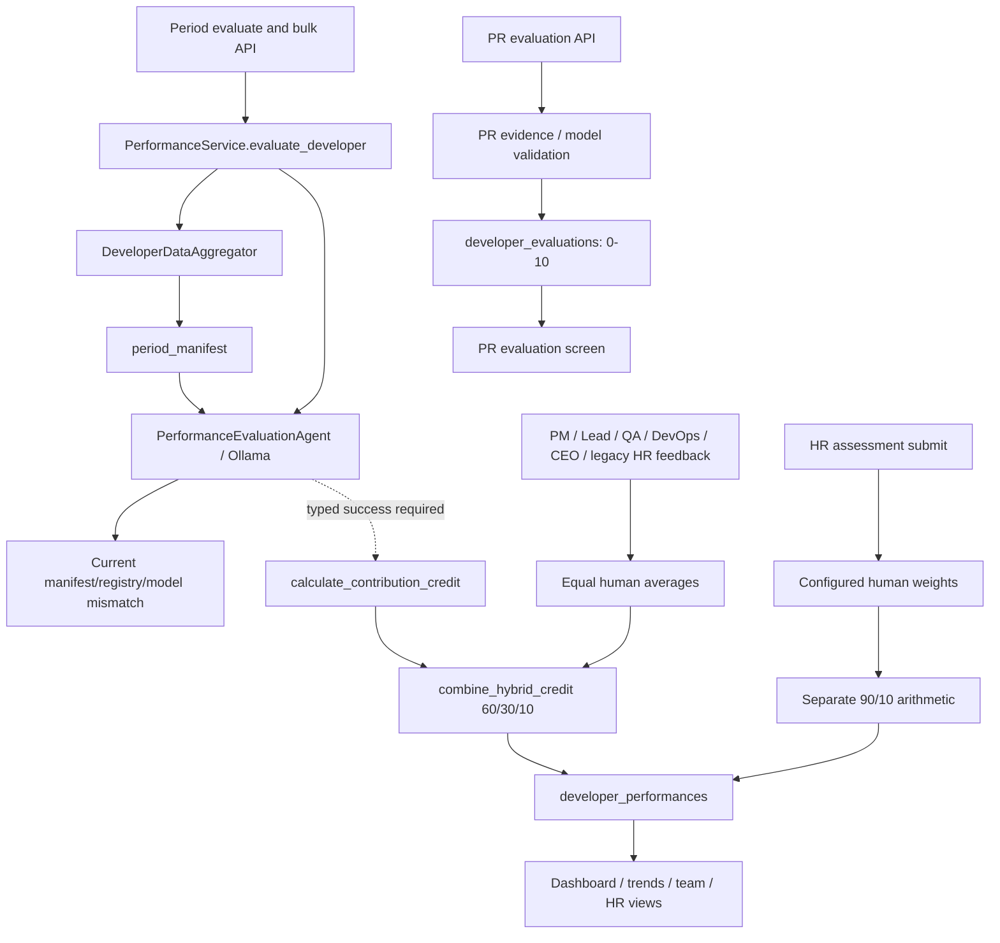

# Scoring architecture: Phase 0 audit

Date: 2026-11-12. Branch: `testing`. Inspected commit: `28de5f935d41ae12c3e055e29d17c8ab1603e9cc`.

Input: `SAMANVAYA_SCORING_ARCHITECTURE_IMPLEMENTATION_SPEC.md`, prepared 2026-11-11 and referencing the earlier `d019b1ca` snapshot. The supplied document was read completely and not edited.

Scope: the user authorized Phase 0 after supplying the scoring architecture specification. Production code, policy weights, stored employee assessments, frontend behavior, and Git history remain unchanged. This report does not implement or approve a new scoring policy.

## Findings that determine the implementation order

1. The existing period pipeline is currently blocked before valid model scoring: the agent requires a citation `sources` map that the manifest never returns. Supplying that missing contract in an isolated probe exposes additional incompatible dimension names and required model fields. Merely changing the final formula will not repair this pipeline.
2. There are competing period aggregate formulas and inconsistent human aggregation. The HR path calculates `77.66` for a legacy engineering contribution of `77.4/90` and human `80/100`; the proposed normalized 90/10 example would be `85.4` after interpreting engineering as `86/100`.
3. Missing observations can generate a stored zero score with a `C+` grade, invented neutral criteria, or an apparent final score before human review. Existing `credit_status=advisory` means these records are **not** evidence of a canonical approved-assessment lifecycle, even though APIs/UI expose `final_score` and `grade`.
4. Repeating identical human feedback changes a score from `70` to `76`. The previous composite is incorrectly reused as the objective input. Two simultaneous feedback submissions can also overwrite one another.
5. Two scoring-specific authorization gaps were reproduced at the HTTP boundary using synthetic authenticated principals: an HR account in organization A can read a subject's performance in organization B, and a former engineering contributor now in HR can submit their own historical assessment.

All findings below distinguish direct execution, isolated downstream execution, and source-only limitations. No employee judgment or real personnel record was used.

## Deliverables and reproduction

- [Machine-readable API, model and consumer snapshot](2026-11-12-scoring-contract-baseline.json): 30 operations across 28 paths; 11 named model contracts; 35 OpenAPI component schemas; 121 static scoring call sites (52 runtime); 56 frontend reference locations. Route declarations were cross-checked against generated OpenAPI for the three registered router prefixes. AST call names are an inventory aid, not proof of every possible dynamic edge.
- [Explicit characterization probes](../../backend/tests/audits/scoring_architecture_phase0.py): current observed behavior, including defects. This deliberately does **not** use the default test filename pattern and is not a desired-behavior regression suite. Future phases must replace/convert the affected probes into tests of the approved behavior.
- [Existing-suite baseline runner](../../backend/tests/audits/run_scoring_baseline.py): isolates the import-time audit logger and shortens only oversized pytest reporting IDs to avoid Windows temporary-path failures.

Run from `backend/` using its configured Python 3.12 environment:

```powershell
.venv/Scripts/python.exe -m pytest tests/audits/scoring_architecture_phase0.py -q -s --tb=short -p no:cacheprovider
$env:SAMANVAYA_MONGO_TESTS='1'
Remove-Item Env:SAMANVAYA_DOCKER_BENCHMARK_TESTS -ErrorAction SilentlyContinue
.venv/Scripts/python.exe tests/audits/run_scoring_baseline.py
.venv/Scripts/python.exe -m ruff check . --select F821,E9 --exclude .venv
.venv/Scripts/python.exe -m ruff check tests/audits --select F,E9
```

From `frontend/`:

```powershell
npm run test -- --run --maxWorkers=2
npm run build
npm run lint
```

### Executed baseline

| Check | Actual result |
|---|---|
| Explicit Phase 0 probes | **19 passed**, 27 warnings; probes reproduce current behavior, not fixes |
| Existing full backend suite | **2,468 passed, 111 skipped**, 41 warnings; 65.93 seconds |
| MongoDB | Local 8.3.7 reachable; existing opt-in Mongo tests enabled |
| Docker | Linux engine pipe absent/stopped; Docker opt-in flag disabled; no new container validation claimed |
| Frontend suite | **157 passed**, 20 files |
| Frontend build | Passed; 2,042 modules transformed |
| Frontend lint | Exit 0; 16 existing warnings |
| Backend runtime-name/syntax lint | Ruff `F821,E9` passed |
| New audit utilities lint | Ruff `F,E9` passed |
| Full default backend Ruff | **166 findings**; baseline debt, not repaired in Phase 0 |
| Mypy | Not run: absent from the selected virtual environment |

The 111 skipped backend cases are not passing evidence. They remain excluded from this baseline's validation scope. Pydantic configuration/datetime deprecations and contribution-credit serialization warnings were recorded rather than suppressed. The earlier November 11 run with Docker enabled is historical evidence and is not substituted for today's execution.

Full default Ruff statistics were: 92 unused imports (F401), 27 unused redefinitions (F811), 25 unused variables (F841), 16 import-order violations (E402), two true/false comparisons (E712), two placeholder-free f-strings (F541), one lambda assignment (E731), and one ambiguous name (E741). Runtime-name/syntax checks were separately green; no clean full-style-lint or type-check claim is made.

The first characterization run revealed that the global `AuditLogger` retained its import-time collection. One synthetic policy audit event reached `samanvaya_test.audit_logs`; it was located and removed using its exact ObjectId, timestamp, actor and payload. The harness now binds that logger to the in-memory store, and a probe asserts its audit event is written there. No employee/performance records in a real database were created or altered by these probes. Historical production database shapes and real HR evidence were not sampled or exported.

## Current call graph



The dotted path is conditional: current real parser failures must not be confused with a working live Ollama-to-period-score flow. PR evaluation is a separate contribution-level system. The generic AI invoke route uses the supervisor's code/QA/DevOps/meeting/CI/HR agents, not `PerformanceEvaluationAgent`, and does not write the period-performance collection in its inspected invocation path.

## F1-F13 verification matrix

| ID | Classification | Evidence and consequence |
|---|---|---|
| F1 | Reproduced arithmetic; active service consumers | [Legacy combiner](../../backend/intelligence/contribution_credit.py#L122) uses 60/30/10. Objective 50, normalized model 86 and human 80 give **63.8**. Missing H changes effective objective/model weights to 2/3 and 1/3. Equal objective and normalized model values can coincidentally hide the conflict in the 85.4 example. |
| F2 | Reproduced numeric influence at aggregate boundary; live parser blocked | Keeping evidence and H fixed, changing model input from 18/90 to 81/90 changes the aggregate **44 to 65**. [Period orchestration](../../backend/domain/services/performance_service.py#L122) consumes this number despite advisory wording. This does not establish a currently successful real model response: F3 blocks that path. Citation existence would not validate numerical judgment even after F3 is fixed. |
| F3 | Reproduced runtime blockers; coverage unit issue source-confirmed | Actual [parser](../../backend/agents/performance_agent.py#L72) raises `KeyError: sources` for an eligible PR manifest. Isolating only that missing manifest contract reveals `KeyError: innovation`; a known `code_quality` dimension then fails the required five missing breakdown fields. The [fractional registry](../../backend/intelligence/evaluation_scoring.py#L13) disagrees with [point-valued model dimensions](../../backend/domain/models/developer_performance.py#L8). `assessed_weight / 90 * 100` is also inconsistent with fractional weights (full weight 1 would display 1.11%); a valid returned live assessment cannot currently be used to verify that metadata because earlier stages fail. |
| F4 | Reproduced gaming/duplication sensitivity; fairness remains a policy question | One merged PR produces **8** points; duplicating the same PR ID produces **16**. Activity counts and task story points directly award points without deduplication or an approved outcome measurement. No empirical fairness conclusion is claimed. |
| F5 | Reproduced disagreement and missing-review normalization | Identical Lead 100 and PM 20 inputs produce **60** in the ordinary service and **63.08** under the default policy. HR/QA are missing, but the HR aggregate is still numeric. Completeness exists as a separate query, not a mandatory scoring gate. |
| F6 | Reproduced service behavior; default-policy nuance | CEO-only ordinary feedback yields H=100. Configuring `{'ceo': 1.0}` is accepted by the policy service. **The default HR policy does not weight CEO**; the problem is the ordinary calculator plus the ability to activate CEO weight. Historical CEO records must remain readable. |
| F7 | Reproduced persisted placeholder | Empty HR dimensions create a performance record with AI=0, `final_score=0`, **grade C+** because the grade fallback uses 75. The [completeness](../../backend/domain/services/hr_performance_service.py#L505) path constructs a zero placeholder in memory but does **not** itself persist it; that distinction corrects an overly broad reading of the specification. |
| F8 | Reproduced scale/double-weight defect | Existing AI contribution 77.4/90 and eligible HR H=80 produce **77.66**, not the normalized example's 85.4, through [HR submission](../../backend/domain/services/hr_performance_service.py#L474). No model-output or fair-rubric validation is implied by this arithmetic fixture. |
| F9 | Reproduced fabricated compatibility observations | No observed HR dimensions leave `normalized_score=null` but persist compatibility criteria **[3,3,3,3]** via `rating or 3`. Raw observations and legacy fields therefore disagree; later criteria-based consumers can interpret invented data. |
| F10 | Reproduced false sufficiency/metadata | Twenty copies of one commit are classified `EXCELLENT`. A manifest with start after end still reports `has_sufficient_evidence=true` and `period_validated=true`, alongside an invalid-period warning. Collector filtering exists, but the manifest is not a validated evidence snapshot. |
| F11 | Distinct supported scope; not intrinsically a defect | PR `DeveloperEvaluation.overall_score` accepts 8.6 and rejects 86, enforcing 0-10. Period scores use 0-100, with legacy AI contribution 0-90. No direct transfer of the PR evaluation collection into the period collector was found. Preserve this separation and bridge only typed validated facts if later authorized. |
| F12 | Reproduced orchestration after synthetic typed upstream success | With a valid typed upstream AI response and no human review, the service persists `final_score=28.67`, grade F, status **advisory**. This is not an approved assessment, but the numeric/grade fields are already exposed by dashboards. The probe isolates orchestration; it does not bypass F3 and claim the unmodified real model flow succeeds. |
| F13 | Narrow concurrency and access concerns reproduced; remaining governance gaps source-only | Two controlled read-before-write feedback requests both succeed, but only one review survives. Actual HTTP routes return 200 for an organization-A HR reader viewing a B subject, and for a now-HR subject submitting their own historical engineering assessment. JWT authentication is replaced by consistent synthetic principals for these route tests; this is not a signed-token exploit demonstration. Immutable approval transitions, assessment revisions and broader export guarantees are absent/unestablished rather than claimed implemented. |

### Additional discrepancies found during Phase 0

- **A1 — Collector/manifest key mismatch (reproduced):** [collector](../../backend/intelligence/developer_data_aggregator.py#L117) emits `tasks` and nested `period.start/end`, whereas the manifest expects `completed_tasks`, `completed_stories`, and top-level `period_start/end`. One collected completed task is recognized as zero completed tasks. Stories and real CI data are not collected into the manifest's expected format; `ci_cd_logs` is initialized but not populated by this collector.
- **A2 — Feedback retries amplify a composite (reproduced):** [feedback recalculation](../../backend/domain/services/performance_service.py#L286) uses previous `contribution_credit.score` as the new objective score. Identical retries give **70 then 76**, without new work or a new review. Fixing weights alone will not resolve this data-lineage defect.
- **A3 — Ollama outage prevents deterministic work (reproduced):** the real period service propagates a model timeout before reaching contribution calculation; no deterministic performance row is persisted. The combiner's `ai_available=false` support does not create a service-level outage fallback on its own.
- **A4 — Source-only integrity limitations:** period dates are often naive and quarter ends inclusive; task queries use `$lte` and no project predicate in `find_by_assignee_and_date`; collectors cap GitHub records and swallow failures into empty data without a complete source-availability contract. These require scoped tests and approved attribution/coverage semantics before implementing Phase 2.
- **A5 — Source-only governance limitations:** policy configuration accepts a sum tolerance of 0.99-1.01, permits `scrum_master` although the human aggregator has no corresponding rating field, uses globally active policy records, and labels the configuring audit actor as ADMIN rather than retaining their actual role. These are investigation/contract items, not newly invented authority rules.

## Runtime and API inventory

The JSON snapshot contains exact paths, methods, source lines, endpoint names, dependencies, schemas and the complete name-based call-site inventory. The grouped inventory below records behavior and migration consequences.

| Entry points | Owning path | Current behavior / migration boundary |
|---|---|---|
| POST `/api/performance/evaluate`, `/evaluate/bulk` | [performance routes](../../backend/api/routes/performance.py#L74) -> `PerformanceService.evaluate_developer` | Permission-gated; bulk actually loops and awaits work before responding despite async-operation wording. Single request accepts client employee/name/email/repository/evaluated_by fields. Current period parser uses naive dates. Subject/project/org applicability must be enforced centrally during migration. |
| POST `/api/performance/feedback/{id}/{pm,lead,qa,devops,ceo,hr}` | `PerformanceService.add_role_feedback` | Legacy 1-5 role fields; ordinary equal averages; full-document update. PM/Lead/QA/DevOps/CEO use a task-visibility helper that is not reviewer eligibility. Legacy HR feedback does not invoke that helper. Do not delete historical endpoints/models before consumer migration. |
| GET/POST `/api/performance/assessment/hr/{id}`, POST `.../submit` | `HRPerformanceService`, assessment repository | Draft/submitted HR records and period score mutation are coupled on submit. Role permissions exist; tested organization/subject/self-review gaps remain. |
| GET `/api/performance/assessments/{id}/completeness` | HR service | Returns pending roles separately; creates no persisted period assessment on this read path. Does not gate other write paths. |
| GET/POST `/api/performance/policy`, GET `/policy/history` | Policy service/repository | New version strings and historical records exist; current active policy is global. Activating a new policy deactivates older records; there is no independent activation approval or assessment snapshot lock. |
| POST `/api/performance/credit/{id}/appeal` | Direct performance repository write | Own subject/admin check and attributable audit event exist. A single `appeal` object/status is overwritten, rather than an append-only appeal/revision lifecycle. |
| GET `/api/performance/developer/{id}`, `.../trend`, `/dashboard/{id}`, `/team/{project}/{period}` | Period service/repository and HR serializers | `final_score`, grade, trend, role summary and compatibility aliases are already consumed. HR redaction exists but is not a substitute for org scope or approval gating. Specific-project team path lacks the accessible-project filtering applied to the special all/current branch. These latter paths are source-inspected, not separately exploited here. |
| POST `/api/evaluation/evaluate`; GET `/latest`, `/employee/{id}`, `/repository/{owner}/{repo}/pr/{number}`, `/{evaluation_id}`, `/health` | [PR evaluation routes](../../backend/api/routes/evaluation.py) and `EvaluationRepository` | Separate 0-10 PR contribution scores, source manifests, citation/claim checks, coverage and duplicate persistence. CEO/Lead invocation gate exists; employee/repository scope and authoritative human-score provenance need independent assessment before using these outputs as period facts. Health is unscored. |
| POST `/api/ai/invoke`, GET `/runs`, `/runs/{id}`, `/health` | [generic AI routes](../../backend/api/routes/ai.py) / supervisor / AI-run repository | Permission check, accessible-project context and HR response filtering exist. Generic agent registry has no employee-period evaluator. No direct write to `developer_performances` was found in this path. Do not conflate AI run visibility with scoring approval. |

### Calculators and consumers

| Component | Active callers / semantics |
|---|---|
| `calculate_contribution_credit` | Period evaluation service and direct tests; count-based objective points, marked advisory but later combined into `final_score`. |
| `combine_hybrid_credit` | Initial evaluation and role-feedback recalculation; 60/30/10, normalizes absent components. |
| `PerformanceService._calculate_role_scores` | All legacy role-feedback submissions; equal average over available roles, CEO included. |
| `HRPerformanceService.calculate_aggregated_human_score` | HR submit and completeness; configured weights normalized among available reviewers. |
| `PerformanceEvaluationAgent` | Period service and HR service construction; `evaluate_performance` invoked by period evaluation, not the generic supervisor. HR-filtered agent method has no normal period-service caller passing HR context; tests exercise it directly. |
| `evaluation_scoring.py` utilities | Fractional registry feeds the period agent. Name-based search found no runtime calls to its separate `calculate_overall_score`, normalization, percentile, multi-period or trend helpers; preserve/classify as utility/legacy rather than treating every helper as an active final formula. |
| PR `_calculate_focus_score` / `_run_ai_evaluation` | PR evaluation route only; scalar 0-10 and PR-scoped evidence validation. |
| [Frontend performance client](../../frontend/src/api/performance.api.js) | Dashboard, detailed period view, trend, team, single/bulk evaluate, policy/history/configuration. |
| [Frontend PR evaluation client](../../frontend/src/api/evaluation.api.js) | Contribution evaluation create/latest/detail/employee/PR lists; separate screen and semantics. |
| [Performance page](../../frontend/src/pages/performance/PerformancePage.jsx), [developer dashboard](../../frontend/src/pages/developer/DeveloperDashboardPage.jsx), [PR evaluation page](../../frontend/src/pages/evaluation/AIEvaluationPage.jsx) | Existing scoring consumers. Dashboard maps `final_score` to `overall_score` and legacy breakdown names to `delivery_speed`, `business_impact`, `technical_judgment`; absent canonical status must not be treated as approval during UI migration. |

Direct scoring-construction/call tests are `test_contribution_credit.py`, `test_hr_performance_assessment.py`, `test_ai_authorization.py`, and `test_review_regressions.py`. API/PR/consumer baselines additionally include `test_evaluation_engine.py`, `test_evaluation_validation.py`, `test_performance_hr_filtering.py`, performance-page/stress tests and PR-evaluation-page tests. The JSON inventory preserves exact static references instead of assuming all similarly named test files exercise the period engine.

## Storage and historical compatibility snapshot

| Store | Current identity / versioning | Required migration caution |
|---|---|---|
| `developer_performances` | ObjectId, developer/project/period fields, required AI evaluation, `final_score` and grade; optional contribution methodology/history and free string `credit_status` | Indexes use developer/start and unique developer/period label, not org/role/rubric/revision. Updates replace fields without expected-revision checking. No canonical immutable evidence snapshot, approved E/H/S or period-role profile. Preserve old meanings and numbers; add a new versioned schema rather than reinterpret fields in place. |
| `hr_assessments` | Assessment/performance/developer/evaluator IDs, dimensions, submitted status, policy version | Repository falls back from performance ID to developer ID/latest record. Draft/submission updates overwrite the existing assessment. No period-scoped independent revision or organization key is enforced here. |
| `evaluation_policies` | Policy ID/version, role weights, active flag, configured actor/time | Global active lookup, with default seeding on read. Used policy versions need explicit scope, effective dates, activation governance and frozen content before new finalization. |
| `developer_evaluations` | PR employee/repository/number/head SHA/focus; duplicate key and schema/evidence validation flags | Better contribution-level provenance is present. Duplicate identity is still distinct from an employee-period revision, and lacks a rubric/governance period identity. Never silently rescale these 0-10 values into period credit. |
| `audit_logs`, `ai_runs` | Attributable events and model-run artifacts | Audit logger catches persistence failures and prints them rather than enforcing an approval transaction. AI-run history is not an immutable assessment ledger. |

Legacy model units remain: period `final_score` 0-100; AI contribution 0-90; ordinary role contribution 0-10; ordinary role ratings 1-5; HR dimension ratings 1-4; normalized HR 0-100; PR overall 0-10. A model accepting a bounded number does not verify that its inputs or units are correct.

## Safe handoff to Phase 1

Phase 0 is complete for the inspected revision and stated validation scope. No finding is marked fixed. The next phase should add canonical nullable E/H/S contracts, a consistent role/rubric registry, explicit units and methodology/revision identifiers, and deliberate legacy serializers. Existing numeric fields and historical records must remain unchanged while shadow/new contracts are introduced.

Do not activate example rubric weights, coverage thresholds, reviewer substitutions, rating-anchor conversions, grade bands or approval policy from the document as production policy. They are explicitly OPEN. Unapproved profiles must remain non-finalizable. Schema/registry engineering can proceed with pending policy states; it does not require fabricating calibrated values.

The missing manifest/citation contract, non-idempotent feedback lineage, scope/self-review checks and lost-update behavior need explicit regression requirements in their owning phases. They should not be hidden by a new weighted sum. Full role redesign, new monitoring/RAG infrastructure, dashboard redesign, production-data migration and commits/pushes were not part of this authorization.
