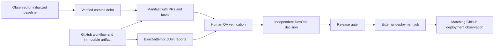

# Multi-PR release management

## Activation

Set `RELEASE_MANAGEMENT_ENABLED=true` in the controlled backend environment and restart the API. It defaults to false. Configure `RELEASE_TRUSTED_BUILD_REF` (default `main`), `RELEASE_TRUSTED_WORKFLOW_PATH` and `RELEASE_TRUSTED_WORKFLOW_SHA256` with the exact protected branch, workflow path and workflow file SHA-256. Set `RELEASE_REQUIRED_TEST_SUITES` to a comma-separated list of required `artifact-name/report.xml` identities. Set `RELEASE_MIN_COVERAGE_PERCENT` to a positive threshold to require measured coverage. It defaults to 0. The frontend reads availability from the API. [TaskFlow rehearsal and workflow examples](taskflow-multi-pr-pilot.md)

## Scope and evidence

A candidate covers one repository and the production environment. A verified GitHub deployment can establish the baseline. In the absence of a deployment observation, an assigned DevOps reviewer must initialize the baseline with an exact provider-verified commit and an auditable reason. Forward discovery requires ancestry proof from GitHub. The manifest stores commits, verified PR associations, deduplicated project task links, stories, acceptance criteria, ambiguous changes and revert references. A direct commit, ambiguous merge attribution, incomplete comparison or missing task association prevents approval. A hotfix follows the same rules. Rollbacks are recorded as incomplete candidates pending a separate execution policy.

The protected workflow must have run successfully on a push from the configured repository and branch. Samanvaya checks the workflow file at the target revision, pins the run attempt and checks the archive bytes against GitHub's immutable artifact digest. Installing the workflow on a protected ref and pinning its dependencies are part of the operational trust policy. A newer applicable run or rerun requires fresh evidence. GitHub's archive digest, run identity, and attempt-specific publication make the build and JUnit evidence independently addressable. The combined candidate must pass the configured report set. Unavailable coverage is shown as missing.

## Review and durable history

Only an assigned QA reviewer can verify every task against the exact manifest, build and current combined test evidence. An assigned DevOps reviewer independently approves or holds. Current memberships are checked at gate evaluation. PM, Lead and Developer project members can read release detail. Technical review is outside the HR and CEO views. PR-head Code and QA advisories can supply context through existing tools. They are outside the gate decision.

Drafts become actionable when scope, artifact and QA evidence are complete. Submit claims the active production release slot. A hold remains until a current independent approval or supersession. Changed scope and evidence require fresh review. A released candidate needs a matching signed GitHub deployment status carrying its release ID, artifact ID, digest and manifest digest after receipt of an allow decision. The gate's successful response alone leaves deployment unconfirmed. A new hold can stop a subsequent check. GitHub may already have started a deployment by then.

MongoDB stores the following records.

- `release_environments` stores the initialized baseline and active candidate for each project, organization and environment.
- `release_candidates` stores a deterministic candidate key from the immutable inputs. Indexes support project and repository/target lookups.
- `release_revisions` appends a single unique successor per release and version. It preserves the reviewed manifest, its digest and human decisions. Repeated identical actions return the winning revision when it is current.
- `release_gate_receipts` records the first successful check for a reviewed approval and manifest. Candidate-specific deployment status requires that receipt and exact payload identity.

## HTTP contracts

Project endpoints require an authenticated user with current project membership. Mutations perform server-side role checks.

| Operation | Endpoint under `/api/projects/{project_id}/releases` |
| --- | --- |
| Paginated list | `GET` with `offset` and `limit` |
| Initialize baseline | `POST /baseline` with revision and reason |
| Discover candidate | `POST` with baseline SHA, target SHA, run ID, artifact ID and kind |
| Evidence and current state | `GET /{release_id}` |
| Historical decisions | `GET /{release_id}/history` with pagination |
| Historical manifest | `GET /{release_id}/history/{version}` |
| Review and lifecycle changes | `POST /{release_id}/actions` with action, version, reason and current evidence digest. QA verification includes the complete set of reviewed task IDs and explicit acknowledgement of uncertain reverts when present. |

The existing `POST /api/release-gates/check` also accepts release ID, revision, artifact ID and digest. It uses the same project credential. With release management enabled, the legacy mode additionally requires a verified baseline and a provider-discovered delta containing exactly the approved task and PR. A registered candidate must use its release ID. Disabled mode preserves the existing pilot API behavior.

## Rehearsal status

Controlled tests use provider fixtures and a disposable MongoDB database. The workflow examples perform a harmless marker. Live verification requires secret rotation, authorized installation in the pilot repository, a combined revision and independent human reviews.
